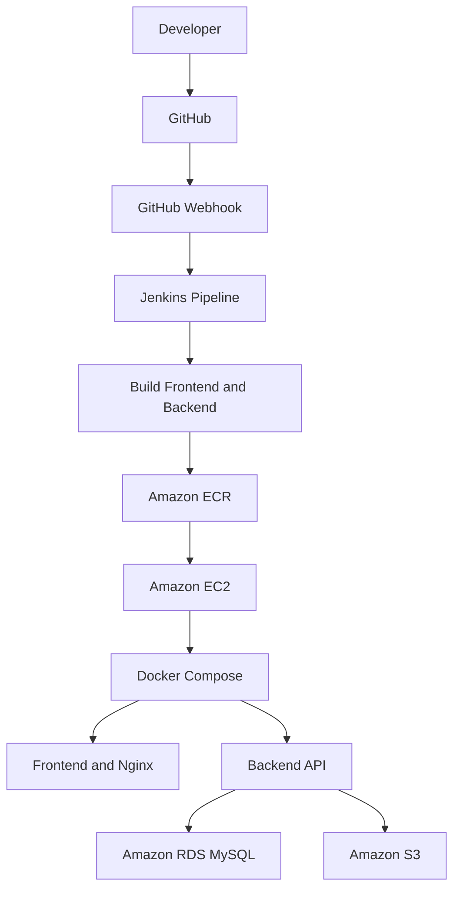

# CloudCart — Cloud-Native E-Commerce Platform with DevOps & CI/CD
A full-stack e-commerce application built with React, Node.js, Express, and MySQL, deployed on AWS using Docker, Jenkins, and automated CI/CD. The project demonstrates containerization, cloud infrastructure, database integration, object storage, and automated deployment.


**Repository:** [CloudCart-devops](https://github.com/Talhakhan28/CloudCart-devops)

## 📑 Table of Contents

- [Project Overview](#-project-overview)
- [Demo Credentials](#-demo-credentials)
- [Features](#-features)
- [Tech Stack](#-tech-stack)
- [Architecture](#-architecture)
- [AWS Infrastructure](#-aws-infrastructure)
- [CI/CD Pipeline](#-cicd-pipeline)
- [Project Structure](#-project-structure)
- [Local Setup](#-local-development-setup)
- [Database & Migrations](#-database--migrations)
- [Production Deployment](#-production-deployment)
- [Environment Variables](#-environment-variables)
- [Security](#-security)
- [Testing & Troubleshooting](#-testing--troubleshooting)
- [Cost Management](#-cost-management)
- [Future Improvements](#-future-improvements)
- [What I Learned](#-what-i-learned)
- [Author](#-author)

## 📌 Project Overview

CloudCart is a containerized e-commerce platform with a React frontend, Node.js/Express backend, and MySQL database. It runs on Amazon EC2, stores images in Amazon S3, and uses Amazon RDS for managed database hosting.

Jenkins automates Docker image builds, pushes images to Amazon ECR, and deploys updated containers using Docker Compose. GitHub webhooks trigger the pipeline on code pushes.

## 🔑 Demo Credentials

Use these accounts for testing if they are seeded and enabled in the deployed application.

| Role | Email | Password |
|---|---|---|
| Admin | `admin@cloudcart.local` | `Admin@123` |
| Customer | `alice@cloudcart.local` | `Customer@123` |

**Note:** These are demo credentials, not production credentials. Change or disable seeded accounts before using the application for real customers.

## ✨ Features

### E-Commerce
- Product browsing, categories, search, filtering, and sorting.
- User authentication and customer profiles.
- Shopping cart and checkout.
- Order history and order management.
- Admin dashboard for products, categories, customers, and orders.
- Product image uploads and storage.

### DevOps & Cloud
- Dockerized frontend and backend.
- Docker Compose service orchestration.
- Jenkins Declarative CI/CD pipeline.
- GitHub webhook integration.
- Versioned Docker images in Amazon ECR.
- Automated deployment to EC2.
- Persistent Docker volume for uploaded files.
- Container health checks and deployment verification.

## 🛠️ Tech Stack

| Category | Technologies |
|---|---|
| Frontend | React, Vite, JavaScript |
| Backend | Node.js, Express.js |
| Database | MySQL, Prisma |
| Authentication | JWT, bcryptjs |
| Web Server | Nginx |
| Containers | Docker, Docker Compose |
| CI/CD | Jenkins |
| Version Control | Git, GitHub |
| AWS Compute & Registry | EC2, ECR |
| AWS Database & Storage | RDS MySQL, S3 |
| AWS Networking & Access | VPC, subnets, security groups, IAM |
| Operating System | Ubuntu Linux |
| Automation | Jenkins Pipeline, Bash, Docker CLI |

## 🏗️ Architecture

### Application Architecture

```text
                 Browser
                    |
                 Nginx :80
                    |
             Frontend / API Proxy
                    |
              Backend :5000
                /        \
        Amazon RDS       Amazon S3
           MySQL       Product Images
```

### AWS & CI/CD Architecture



### Request & Deployment Flow

1. A code push triggers Jenkins through GitHub.
2. Jenkins checks out the repository and builds both Docker images.
3. Images are tagged with the Jenkins build number and pushed to ECR.
4. Docker Compose pulls the images and updates the application on EC2.
5. The frontend communicates with the backend through the configured Nginx/API routing.
6. The backend connects to RDS MySQL and uses S3 for product images.

## ☁️ AWS Infrastructure

The project uses the `ap-south-1` (Mumbai) region.

| Service | Purpose |
|---|---|
| Amazon EC2 | Hosts Jenkins and application containers |
| Amazon ECR | Stores private frontend and backend images |
| Amazon RDS MySQL | Managed relational database |
| Amazon S3 | Product image storage |
| Amazon VPC | Network isolation and subnets |
| AWS IAM | Role-based permissions for AWS services |
| Elastic IP | Stable public IP for EC2 |

RDS access is controlled through network rules, the S3 bucket is private, and the EC2 IAM role supplies the required AWS permissions.

## 🔄 CI/CD Pipeline

Jenkins job: `CloudCart-CI-CD`

**Pipeline stages:**

1. Checkout source code from GitHub.
2. Build the frontend image.
3. Build the backend image.
4. Authenticate to Amazon ECR.
5. Tag and push both images.
6. Pull the images on EC2.
7. Deploy with Docker Compose.
8. Verify container status and HTTP response.

Images are versioned using Jenkins build numbers, for example:

```text
cloudcart-frontend:3
cloudcart-backend:3
```

### Jenkins Configuration

- **Repository:** [CloudCart-devops](https://github.com/Talhakhan28/CloudCart-devops)
- **Branch:** `main`
- **Pipeline definition:** Pipeline script from SCM
- **Script path:** `Jenkinsfile`
- **Trigger:** GitHub webhook on push events

The pipeline uses AWS CLI authentication and the EC2 IAM role for ECR access instead of hardcoded AWS access keys.

## 📁 Project Structure

```text
CloudCart-devops/
├── client/                       # React frontend
├── server/                       # Express backend
│   ├── prisma/                   # Schema and migrations
│   ├── src/                      # API and application logic
│   └── Dockerfile
├── nginx/
│   ├── Dockerfile
│   └── nginx.conf
├── docker-compose.yml            # Local development
├── Jenkinsfile                   # CI/CD pipeline
├── .env.example                  # Environment template
├── .gitignore
└── README.md
```

The production deployment also uses `/opt/cloudcart/docker-compose.deploy.yml` and `/etc/cloudcart/cloudcart.env` on the EC2 server.

## 💻 Local Development Setup

### Prerequisites

- Git
- Docker Desktop or Docker Engine
- Docker Compose
- MySQL database

### 1. Clone the Repository

```bash
git clone https://github.com/Talhakhan28/CloudCart-devops.git
cd CloudCart-devops
```

### 2. Configure Environment Variables

Create the required local environment files using `.env.example` or the variables expected by the application. Configure the MySQL connection and any required authentication or S3 settings.

Keep real credentials in local environment files and never commit them.

### 3. Build and Start

```bash
docker compose config
docker compose up --build -d
```

Check services and logs:

```bash
docker compose ps
docker compose logs -f
```

Open **http://localhost** in your browser.

Stop the application:

```bash
docker compose down
```

Named volumes are retained unless explicitly removed. Avoid `docker compose down -v` if uploaded data must be preserved.

## 🗄️ Database & Migrations

CloudCart uses MySQL and Prisma migrations to manage its database schema.

Apply committed migrations using the project's configured Prisma command, for example:

```bash
docker compose run --rm --no-deps server npm run prisma:migrate:deploy
```

Review migrations and back up important production data before applying schema changes. Confirm the database target and required permissions first.

## 🚀 Production Deployment

Production services run on EC2 using Docker Compose. The deployment configuration is maintained separately from the source code.

```text
/opt/cloudcart/docker-compose.deploy.yml
/etc/cloudcart/cloudcart.env
```

Pull the configured images:

```bash
docker compose \
  --env-file /etc/cloudcart/cloudcart.env \
  -f /opt/cloudcart/docker-compose.deploy.yml \
  pull
```

Update the services:

```bash
docker compose \
  --env-file /etc/cloudcart/cloudcart.env \
  -f /opt/cloudcart/docker-compose.deploy.yml \
  up -d
```

Verify the deployment:

```bash
docker compose \
  --env-file /etc/cloudcart/cloudcart.env \
  -f /opt/cloudcart/docker-compose.deploy.yml \
  ps

curl -I http://localhost/
```

These deployment steps are automated by Jenkins after a successful code push.

## ⚙️ Environment Variables

The application uses environment variables for database connectivity, authentication, runtime configuration, and AWS/S3 integration.

| Variable / Setting | Purpose |
|---|---|
| `DATABASE_URL` | MySQL connection string |
| `JWT_SECRET` | Authentication signing secret |
| `PORT` | Backend port |
| `CLIENT_URL` | Frontend origin |
| `VITE_API_URL` | Frontend API path; production uses `/api` |
| AWS/S3 settings | Region, bucket, and required storage configuration |

Use the exact variable names expected by the current application code. The production environment file is kept outside Git and supplied to Docker Compose during deployment.

## 🔐 Security

- Use IAM roles instead of hardcoded AWS access keys.
- Keep production secrets and `.env` files out of Git.
- Keep S3 Block Public Access enabled.
- Restrict RDS access through security groups.
- Keep backend-only secrets out of frontend variables.
- Restrict access to production environment files.
- Use HTTPS for public application traffic.
- Review AWS permissions and update software regularly.

**Known hardening task:** Jenkins port `8080` is currently publicly accessible. Restrict access and configure a secure HTTPS access path before treating Jenkins as production-ready.

## ✅ Testing & Troubleshooting

The CI/CD workflow has completed a successful build and deployment, including ECR image publishing, Compose deployment, backend health verification, and an HTTP response check.

For future releases, verify:

- GitHub push triggers Jenkins.
- Both images build and push successfully.
- EC2 deploys the intended image tags.
- Frontend and backend containers are healthy.
- Login, products, cart, orders, and admin functions work.
- Product images load correctly.
- Database connectivity and persistent uploads work as expected.

### Common Troubleshooting Checks

| Issue | What to Check |
|---|---|
| Jenkins build fails | Console Output, Docker build and pipeline stages |
| ECR authentication fails | AWS region, IAM permissions, repository names |
| Backend cannot connect to MySQL | Endpoint, credentials, security groups, VPC |
| Frontend API errors | Nginx proxy, API URL, backend health and logs |
| Product images fail | S3 configuration, IAM permissions, object keys |
| Volume issues | Docker volume configuration and container mounts |

Useful commands:

```bash
docker ps -a
docker volume ls
docker logs <CONTAINER_NAME>
docker compose ps
```

Avoid deleting volumes during troubleshooting until you have confirmed their data is no longer required.

## 💰 Cost Management

Potential AWS costs include EC2, Elastic IP usage, RDS, ECR storage, S3 requests/storage, data transfer, and enabled monitoring.

- Stop development resources when not needed.
- Review RDS and storage charges before changing resources.
- Remove unused images and resources carefully.
- Configure AWS Budgets and billing alerts.
- Remember that stopping EC2 does not stop every associated billable resource.

## 🔮 Future Improvements

- Secure Jenkins with restricted access and HTTPS.
- Add automated application tests and image vulnerability scanning.
- Implement centralized monitoring and logging.
- Add deployment rollback procedures.
- Explore Terraform for infrastructure as code.
- Explore Kubernetes for container orchestration.
- Improve backup, recovery, and secret management.

## 📚 What I Learned

- Linux server administration and Git workflows.
- Docker, Docker Compose, and container health checks.
- Jenkins pipelines and GitHub webhook integration.
- AWS EC2, ECR, RDS, S3, IAM, and VPC.
- MySQL connectivity and Prisma migrations.
- Environment configuration and secret handling.
- Automated deployment, verification, and troubleshooting.
- Persistent storage and cloud cost awareness.

## 👨‍💻 Author

**Talha Khan**  
Computer Science Graduate | Aspiring DevOps / Cloud Engineer

- **GitHub:** [Talhakhan28](https://github.com/Talhakhan28)
- **LinkedIn:** [Muhammad Talha Khan](https://www.linkedin.com/in/talha-khan-01265124a/)
- **Portfolio:** [talhakhan28.github.io](https://talhakhan28.github.io/)

## 📄 License

Add an appropriate `LICENSE` file to the repository if you intend to distribute or reuse this project publicly.
